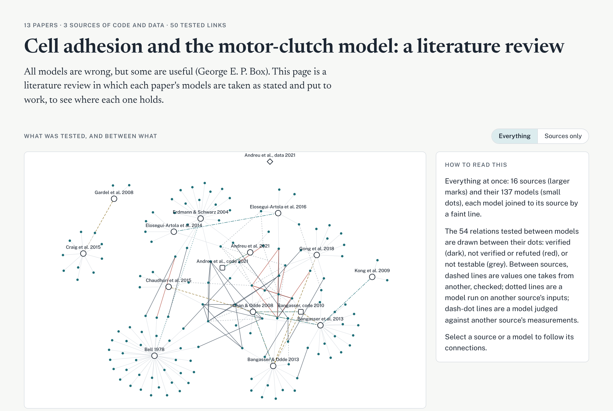
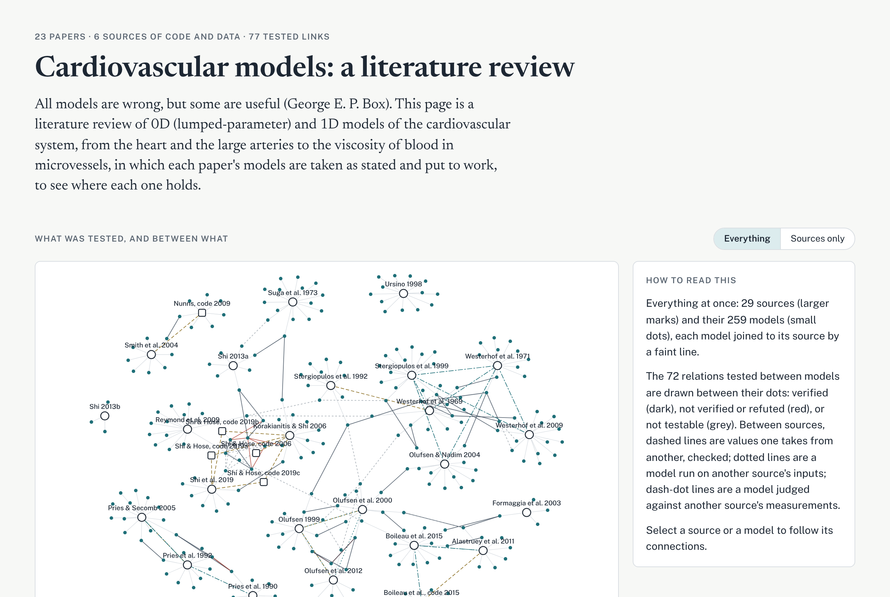
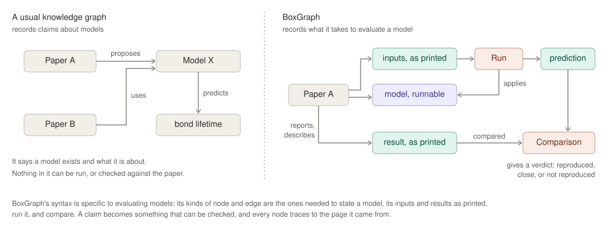
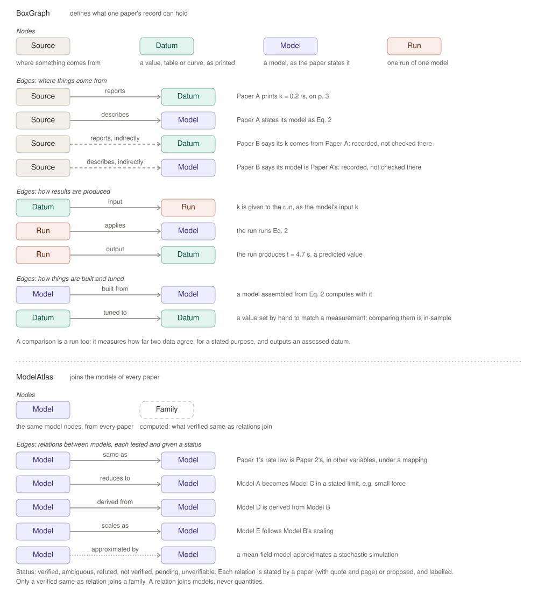
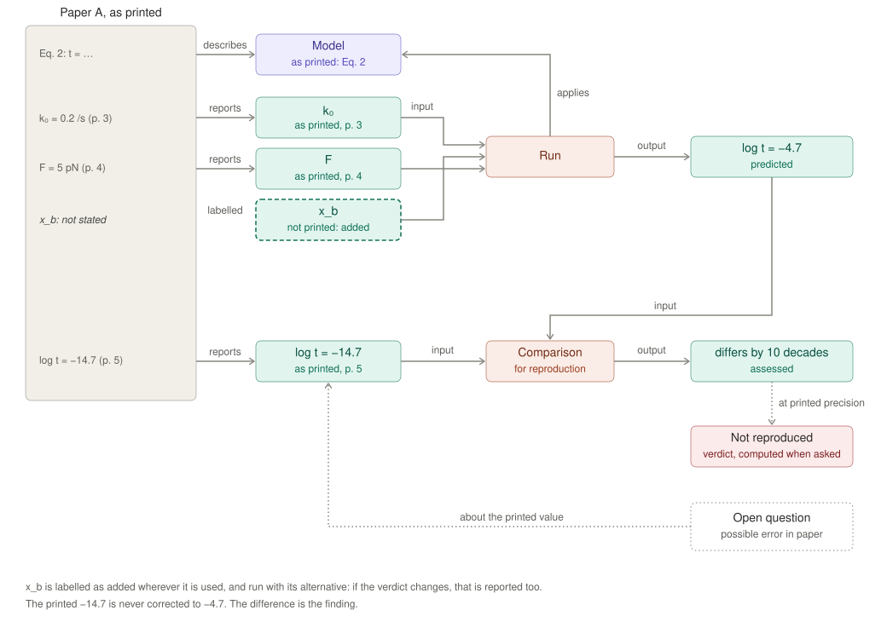
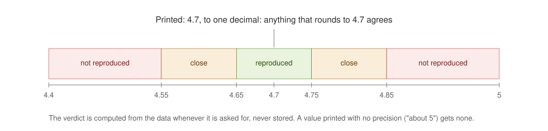
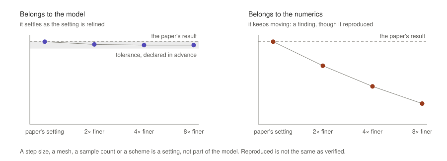
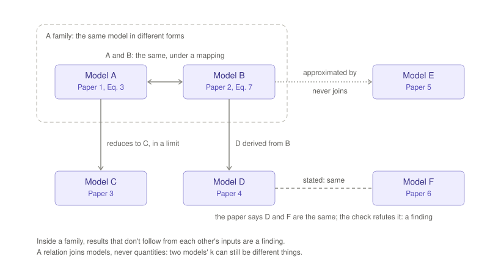
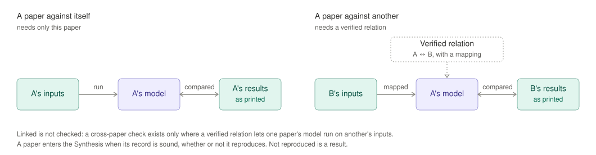

# BoxGraph

> [!WARNING]
> **Work in progress.** BoxGraph and its corpora are under active development, and the
> format, the code and the results may still change. The records are written by agent jobs
> and checked by the validator, but not yet by people. Treat a verdict as a pointer to where
> a paper and its rebuild disagree, not as a finding about the paper, and check the record
> before citing it.

> All models are wrong, but some are useful. — George E. P. Box

Papers build on each other's models and parameter values, but the links are
made in prose and rarely checked, so errors propagate and corrections arrive
slowly. BoxGraph is an executable literature review. Each paper's models are
rebuilt as stated, run on the paper's own inputs, and compared with what the
paper reports and with what other papers measured. Relations between models
in different papers are tested rather than assumed. The result is a record of
where each model holds and where it does not, not a judgement of which model
is correct.

The record is rebuilt each time a source is added, and nothing in it is
overwritten: a disagreement is kept as a result, and a finding in one paper
flags every result elsewhere that depends on it.

- **BoxGraph**: the record format for one source (a paper, its released code,
  or its data) and the validator for it. A record holds every value as printed,
  with its unit, quantity and page; every model as runnable code with declared
  inputs and outputs; the runs of those models; and the comparisons between
  computed and printed values.
- **ModelAtlas**: every model of every source, linked by relations (same as,
  reduces to, derived from, scales as, approximated by), each tested numerically
  or symbolically. Models verified to be the same under a mapping form a family.
- **The Synthesis**: what the build computes from all records: a verdict for
  every comparison at the precision the value was printed with, checks of values
  one paper takes from another, models run on other papers' inputs and judged
  against their measurements, findings,
  and the open questions they raise.

## The Synthesis so far

Two reviews so far, each a corpus of its own in `corpora/<name>/`. Both are
linked from [the landing page](https://elejeune11.github.io/boxgraph-public/).

[](https://elejeune11.github.io/boxgraph-public/motor_clutch/)

**[Open the interactive overview →](https://elejeune11.github.io/boxgraph-public/motor_clutch/)** The
review this README walks through: cell adhesion and the motor-clutch model, from Bell (1978) to
Andreu et al. (2021). Every source and model, joined by what was tested between them
(or the sixteen sources alone, by year), three case studies, and a view of each source. The page
is generated by `boxgraph build` (`build/motor_clutch/overview/index.html`, copied to
`site/motor_clutch/` and served by GitHub Pages); every number on it comes from the records.
The review is kept in [`corpora/motor_clutch/`](corpora/motor_clutch/).

### A second review: cardiovascular models

[](https://elejeune11.github.io/boxgraph-public/cardio/)

**[Open the cardiovascular overview →](https://elejeune11.github.io/boxgraph-public/cardio/)** The
same method on a second field, kept as a corpus of its own in [`corpora/cardio/`](corpora/cardio/):
0D (lumped-parameter) and 1D models of the circulation, from the heart and the large arteries
to the viscosity of blood in microvessels and the coronary circulation, down to human capillary beds. Fifty-two sources: papers, two
chapters of a thesis, released CellML models, a released benchmark data set, the released data of
coronary models, and three released SimVascular codes (the 0D and 1D solvers and a vascular tree
generator), built and run. Its case studies show an equation that, as
printed, has the wrong dimensions and the corrected form its figure follows; a human coronary
arterial tree of about 200,000 segments, released by its authors and solved again, which reproduces
the paper's flows and settles a sign misprinted in its conductance law; a generated vascular tree set
against the measured human tree; a 1D solver run against its paper and against 3D benchmark solutions;
and a parameter carried through three papers that is consistent with the equations printed beside it
in none of them. Its sources are listed in [`corpora/cardio/papers.yaml`](corpora/cardio/papers.yaml).

## Contents

1. [The Synthesis so far](#the-synthesis-so-far): the interactive overviews of the two reviews
2. [The design](#the-design): what BoxGraph, ModelAtlas and the Synthesis are
   - [1 · The goal](#1--the-goal)
   - [2 · BoxGraph](#2--boxgraph)
   - [3 · ModelAtlas](#3--modelatlas)
   - [4 · The Synthesis](#4--the-synthesis)
   - [5 · How it is built](#5--how-it-is-built)
3. [The pipeline and the implementation](#the-pipeline-and-the-implementation): how papers are read into records
4. [Papers in the Synthesis](#papers-in-the-synthesis): the running list
5. [Install](#install), [Use](#use), [Layout](#layout), [A record](#a-record)
6. [Adding papers](#adding-papers): papers, released code and source data
7. [Status](#status)

---

## The design

The design is in [`docs/minimalist_design/`](docs/minimalist_design/README.md),
and it wins over the code. Documents 1 to 4 say what is built and why, and
deliberately say nothing about how the code is written or how agents read;
document 5 fixes the few requirements on the build itself.

| Document | In brief |
|---|---|
| [1 · The goal](docs/minimalist_design/01-goal.md) | The problem (links between papers are made in prose, so errors travel), what we build instead, and the thirteen principles everything else follows. |
| [2 · BoxGraph](docs/minimalist_design/02-boxgraph.md) | The record: four kinds of node, their edges, origins and labels; how one paper becomes a graph; verdicts at the printed precision; values read from figures; code and data as sources; the model against its numerics. |
| [3 · ModelAtlas](docs/minimalist_design/03-modelatlas.md) | Every model kept as its paper states it, joined by five kinds of tested relation; families of models that are the same under a mapping. |
| [4 · The Synthesis](docs/minimalist_design/04-synthesis.md) | What the review holds: verdicts, cross-paper checks, cited values, findings, implications and references; a paper checked against itself and against others. |
| [5 · How it is built](docs/minimalist_design/05-building.md) | Test-driven development, how figures must be read, and why each record keeps the code that reads its figures. |

The figures are generated by
[`make_figures.py`](docs/minimalist_design/figures/make_figures.py).

### 1 · The goal

Quantitative papers build on each other's numbers and models, but nobody
checks that a paper's printed results follow from its own equations, or that
a later paper's "same model" is the same. BoxGraph records what each paper
states, runs what follows from it, tests how papers relate, and reports what
the literature shows as a whole. It checks **consistency, not truth**.
[Read the full document →](docs/minimalist_design/01-goal.md)



*Figure 1. A usual knowledge graph records claims about models, and nothing in
it can be run. BoxGraph gives it a syntax made for evaluating models: the
paper's inputs and results as printed, its model in runnable form, a run, and
a comparison.*

### 2 · BoxGraph

A record has four kinds of node (Source, Datum, Model, Run). A comparison is
a run too, and its output is assessed like any other datum. Every datum has
an origin and a citation. Anything the paper doesn't state is added and
labelled, with its alternatives. A paper's released code and source data are
sources with records of their own, cited by file and line or by sheet and
cell. Verdicts are computed at the precision the paper printed; a near miss
is judged again with the rounding of the printed inputs. An evidently
misprinted equation is run as printed and as a corrected variant, reported
apart. A result that rests on a simulation is checked as its numerical
settings are refined.
[Read the full document →](docs/minimalist_design/02-boxgraph.md)



*Figure 2. The nodes and edges BoxGraph defines, and those ModelAtlas adds.*



*Figure 3. What a paper prints becomes nodes; an input it doesn't print is
added and labelled; a run and a comparison lead to a verdict and an open
question.*



*Figure 4. A value printed as 4.7 allows 4.65 to 4.75. Outside it by no more
than its width again it is close, if it keeps the sign and is within a
factor of ten; beyond that it is not reproduced.*



*Figure 5. Two results that both reproduce at the paper's own setting. As the
setting is refined, one settles (it belongs to the model) and one keeps
moving (it belongs to the numerics, a finding).*

### 3 · ModelAtlas

Each paper's model is a chart, entered as stated. A tested relation with its
mapping is a transition map between charts: `same_as`, `reduces_to`,
`derived_from`, `scales_as` or `approximated_by`. Models that are the same
under a mapping form a family. Nothing is merged, and a stated relation the
test refutes is a finding.
[Read the full document →](docs/minimalist_design/03-modelatlas.md)



*Figure 6. A and B form a family. C, D and E are structure around it
(reduction, derivation, approximation). A claimed relation that fails its
test is a finding.*

### 4 · The Synthesis

The review itself: each paper's verdicts, one paper's model run on another's
inputs where a verified relation allows it or judged against another's
measurements, cited values checked against the
paper they came from (and a paper against its own code and data), findings
and what they put in doubt, and the references worth reading next. A written
review is generated from it, every sentence traced to the records.
[Read the full document →](docs/minimalist_design/04-synthesis.md)



*Figure 7. A paper against itself needs only that paper. A paper against
another needs a verified relation that lets one paper's model run on the
other's inputs. A model against another paper's measurement needs the
quantities the two share, named; a model fitted to that measurement is
reported as a fit.*

### 5 · How it is built

Every rule the checking code holds is written as a test first, on small
hand-written records with known answers, and the test sentences form a
generated catalogue. Every figure that plots data is read, and each reading
is code kept with the record and run again by every build, so a reading is
checked like any other result.
[Read the full document →](docs/minimalist_design/05-building.md)

---

## The pipeline and the implementation

The design leaves the code and the reading open. These documents record how
it is done here.

| Document | In brief |
|---|---|
| [`docs/pipeline.html`](docs/pipeline.html) | The four pipeline figures below with fuller captions, what is kept in git, and the commands (open it locally; GitHub shows its source). |
| [`docs/DECISIONS.md`](docs/DECISIONS.md) | Every choice the design leaves open, as made: storage, units, verdicts, figure readings, the pipeline, code and data as sources. It wins over the plans. |
| [`docs/archive/CODE_PLAN.md`](docs/archive/CODE_PLAN.md) | The original plan for released code and data as sources; what was built is in DECISIONS.md (Code and data as sources). |
| [`docs/TESTS.md`](docs/TESTS.md) | Every test and the rule it checks, grouped by design document; generated from the tests. |
| [`docs/TUTORIAL.md`](docs/TUTORIAL.md) | From a fresh clone to your own papers in the Synthesis, step by step. |
| [`docs/STATUS.md`](docs/STATUS.md) | What exists, results on the papers so far, known limits, next steps. |
| [`pipeline/prompts/record_guide.md`](pipeline/prompts/record_guide.md) | The full authoring guide every reading agent follows. |

The code is in two layers. `boxgraph/` is generic: the schema, verdicts,
runs, validation, ModelAtlas, the Synthesis and the report, and it knows
nothing about any field. `pipeline/` is the replaceable reading layer: it
runs headless agent jobs that write records, each one gated by the
validator.


*From upload to Synthesis. A paper is ingested, then read, audited and its
figures read, one agent per stage. Each new paper is then related to every
record it shows a sign of a relation with, one agent per pair, and a second
agent per pair judges each paper's models against the other's measurements.
The build then makes the Synthesis.*


*Where the pipeline sits. Agents only ever write records. BoxGraph validates
and runs them, ModelAtlas tests their relations, and the Synthesis and its
report are built from them.*


*One agent job. The orchestrator trusts only the files and the gate: an
attempt passes only when the validator says the record is sound and nothing
was written outside the record. Otherwise the session resumes with the
gate's output, and after the last attempt the job is parked for a person.*


*Released code and source data. Each is attached to its paper with
`pipeline.attach`, read after the paper into a record of its own, cited by
file and lines or by sheet and cells, and pinned by a digest of its files.
A relate job links it to the paper by cited values and relations, and the
build runs the code in a sandbox, checks every cited value, and compares
the paper's figures with the data they plot.*

---

## Papers in the Synthesis

Each source has a record under `corpora/<name>/records/<id>/`, and each corpus lists its sources
in `corpora/<name>/papers.yaml`. Updated as papers are added.

### The motor-clutch review ([`corpora/motor_clutch/`](corpora/motor_clutch/papers.yaml))

| Record | Source | Kind | In the Synthesis |
|---|---|---|---|
| [`bell1978`](corpora/motor_clutch/records/bell1978) | Bell, *Models for the specific adhesion of cells to cells*. Science 200, 618-627 (1978) | article | yes |
| [`erdmann2004`](corpora/motor_clutch/records/erdmann2004) | Erdmann and Schwarz, *Stability of adhesion clusters under constant force*. Phys. Rev. Lett. 92, 108102 (2004) | article | yes |
| [`chan2008`](corpora/motor_clutch/records/chan2008) | Chan and Odde, *Traction dynamics of filopodia on compliant substrates*. Science 322, 1687-1691 (2008) | article | yes |
| [`bangasser2013`](corpora/motor_clutch/records/bangasser2013) | Bangasser, Rosenfeld and Odde, *Determinants of maximal force transmission in a motor-clutch model of cell traction in a compliant microenvironment*. Biophys. J. 105, 581-592 (2013) | article | yes |
| [`bangasser2013b`](corpora/motor_clutch/records/bangasser2013b) | Bangasser and Odde, *Master equation-based analysis of a motor-clutch model for cell traction force*. Cell. Mol. Bioeng. 6, 449-459 (2013) | article | yes |
| [`odde_code`](corpora/motor_clutch/records/odde_code) | Odde lab, motor-clutch model with event stepping (MATLAB), released with Chan and Odde 2008 and Bangasser et al. 2013 | software | yes |
| [`craig2015`](corpora/motor_clutch/records/craig2015) | Craig, Stricker, Gardel and Mogilner, *Model for adhesion clutch explains biphasic relationship between actin flow and traction at the cell leading edge*. Phys. Biol. 12, 035002 (2015) | article | yes |
| [`elosegui2016`](corpora/motor_clutch/records/elosegui2016) | Elosegui-Artola et al., *Mechanical regulation of a molecular clutch defines force transmission and transduction in response to matrix rigidity*. Nat. Cell Biol. 18, 540-548 (2016) | article | yes |
| [`andreu2021`](corpora/motor_clutch/records/andreu2021) | Andreu et al., *The force loading rate drives cell mechanosensing through both reinforcement and cytoskeletal softening*. Nat. Commun. 12, 4229 (2021) | article | yes |
| [`andreu2021_code`](corpora/motor_clutch/records/andreu2021_code) | Andreu et al. 2021, Supplementary Software 1: molecular clutch model under cyclic stretch (MATLAB) | software | yes |
| [`andreu2021_data`](corpora/motor_clutch/records/andreu2021_data) | Andreu et al. 2021, source data | dataset | yes |
| [`gardel2008`](corpora/motor_clutch/records/gardel2008) | Gardel et al., *Traction stress in focal adhesions correlates biphasically with actin retrograde flow speed*. J. Cell Biol. 183, 999-1005 (2008) | article | yes |
| [`kong2009`](corpora/motor_clutch/records/kong2009) | Kong et al., *Demonstration of catch bonds between an integrin and its ligand*. J. Cell Biol. 185, 1275-1284 (2009) | article | yes |
| [`elosegui2014`](corpora/motor_clutch/records/elosegui2014) | Elosegui-Artola et al., *Rigidity sensing and adaptation through regulation of integrin types*. Nat. Mater. 13, 631-637 (2014) | article | yes |
| [`chaudhuri2015`](corpora/motor_clutch/records/chaudhuri2015) | Chaudhuri et al., *Substrate stress relaxation regulates cell spreading*. Nat. Commun. 6, 6364 (2015) | article | yes |
| [`gong2018`](corpora/motor_clutch/records/gong2018) | Gong et al., *Matching material and cellular timescales maximizes cell spreading on viscoelastic substrates*. PNAS 115, E2686-E2695 (2018) | article | yes |

### The cardiovascular review ([`corpora/cardio/`](corpora/cardio/papers.yaml))

| Record | Source | Kind | In the Synthesis |
|---|---|---|---|
| [`westerhof1969`](corpora/cardio/records/westerhof1969) | Westerhof et al., *Analog studies of the human systemic arterial tree*. J. Biomechanics 2, 121-143 (1969) | article | yes |
| [`westerhof1971`](corpora/cardio/records/westerhof1971) | Westerhof et al., *An artificial arterial system for pumping hearts*. J. Appl. Physiol. 31(5), 776-781 (1971) | article | yes |
| [`suga1973`](corpora/cardio/records/suga1973) | Suga et al., *Load Independence of the Instantaneous Pressure-Volume Ratio of the Canine Left Ventricle and Effects of Epinephrine and Heart Rate on the Ratio*. Circulation Research 32, 314-322 (1973) | article | yes |
| [`spaan1981`](corpora/cardio/records/spaan1981) | Spaan et al., *Diastolic-systolic coronary flow differences are caused by intramyocardial pump action in the anesthetized dog*. Circ Res 49, 584-593 (1981) | article | yes |
| [`chilian1986`](corpora/cardio/records/chilian1986) | Chilian et al., *Microvascular distribution of coronary vascular resistance in beating left ventricle*. Am. J. Physiol. 251 (Heart Circ. Physiol. 20): H779-H788 (1986) | article | yes |
| [`pries1990`](corpora/cardio/records/pries1990) | Pries et al., *Blood Flow in Microvascular Networks: Experiments and Simulation*. Circulation Research 67, 826-834 (1990) | article | yes |
| [`pries1992`](corpora/cardio/records/pries1992) | Pries et al., *Blood viscosity in tube flow: dependence on diameter and hematocrit*. Am. J. Physiol. 263 (Heart Circ. Physiol. 32), H1770-H1778 (1992) | article | yes |
| [`stergiopulos1992`](corpora/cardio/records/stergiopulos1992) | Stergiopulos et al., *Computer simulation of arterial flow with applications to arterial and aortic stenoses*. J. Biomechanics 25(12), 1477-1488 (1992) | article | yes |
| [`kassab1993`](corpora/cardio/records/kassab1993) | Kassab et al., *Morphometry of pig coronary arterial trees*. Am J Physiol 265 (Heart Circ Physiol 34), H350-H365 (1993) | article | yes |
| [`ursino1998`](corpora/cardio/records/ursino1998) | Ursino, *Interaction between carotid baroregulation and the pulsating heart: a mathematical model*. Am. J. Physiol. 275 (Heart Circ. Physiol. 44), H1733-H1747 (1998) | article | yes |
| [`olufsen1999`](corpora/cardio/records/olufsen1999) | Olufsen, *Structured tree outflow condition for blood flow in larger systemic arteries*. Am J Physiol Heart Circ Physiol 276 (Heart Circ Physiol 45), H257-H268 (1999) | article | yes |
| [`stergiopulos1999`](corpora/cardio/records/stergiopulos1999) | Stergiopulos et al., *Total arterial inertance as the fourth element of the windkessel model*. Am. J. Physiol. 276 (Heart Circ. Physiol. 45): H81-H88 (1999) | article | yes |
| [`olufsen2000`](corpora/cardio/records/olufsen2000) | Olufsen et al., *Numerical Simulation and Experimental Validation of Blood Flow in Arteries with Structured-Tree Outflow Conditions*. Annals of Biomedical Engineering 28, 1281-1299 (2000) | article | yes |
| [`formaggia2003`](corpora/cardio/records/formaggia2003) | Formaggia et al., *One-dimensional models for blood flow in arteries*. Journal of Engineering Mathematics 47, 251-276 (2003) | article | yes |
| [`olufsen2004`](corpora/cardio/records/olufsen2004) | Olufsen and Nadim, *On deriving lumped models for blood flow and pressure in the systemic arteries*. Mathematical Biosciences and Engineering 1(1), 61-80 (2004) | article | yes |
| [`smith2004`](corpora/cardio/records/smith2004) | Smith et al., *Minimal haemodynamic system model including ventricular interaction and valve dynamics*. Medical Engineering & Physics 26, 131-139 (2004) | article | yes |
| [`pries2005`](corpora/cardio/records/pries2005) | Pries and Secomb, *Microvascular blood viscosity in vivo and the endothelial surface layer*. Am J Physiol Heart Circ Physiol 289, H2657-H2664 (2005) | article | yes |
| [`korakianitis2006`](corpora/cardio/records/korakianitis2006) | Korakianitis and Shi, *Numerical simulation of cardiovascular dynamics with healthy and diseased heart valves*. Journal of Biomechanics 39, 1964-1982 (2006) | article | yes |
| [`korakianitis_cellml`](corpora/cardio/records/korakianitis_cellml) | Shi and Hose, Zero dimensional (lumped parameter) modelling of native human cardiovascular dynamics (CellML) (2006) | software | yes |
| [`reymond2009`](corpora/cardio/records/reymond2009) | Reymond et al., *Validation of a one-dimensional model of the systemic arterial tree*. Am J Physiol Heart Circ Physiol 297: H208-H222 (2009) | article | yes |
| [`smith_cellml`](corpora/cardio/records/smith_cellml) | Nunns, Minimal haemodynamic system model including ventricular interaction and valve dynamics (CellML) (2009) | software | yes |
| [`westerhof2009`](corpora/cardio/records/westerhof2009) | Westerhof et al., *The arterial Windkessel*. Med Biol Eng Comput 47, 131-141 (2009) | article | yes |
| [`kim2010`](corpora/cardio/records/kim2010) | Kim et al., *Patient-Specific Modeling of Blood Flow and Pressure in Human Coronary Arteries*. Annals of Biomedical Engineering 38(10), 3195-3209 (2010) | article | yes |
| [`alastruey2011`](corpora/cardio/records/alastruey2011) | Alastruey et al., *Pulse wave propagation in a model human arterial network: Assessment of 1-D visco-elastic simulations against in vitro measurements*. J. Biomech. 44, 2250-2258 (2011) | article | yes |
| [`olufsen2012`](corpora/cardio/records/olufsen2012) | Olufsen et al., *Rarefaction and blood pressure in systemic and pulmonary arteries*. J. Fluid Mech. 705, 280-305 (2012) | article | yes |
| [`shi2013_ch2`](corpora/cardio/records/shi2013_ch2) | Shi, *Chapter 2: Development of a Lumped Parameter Model for the Human Cardiovascular System Including Heart Valve Dynamics and Atrio-ventricular Interaction*. PhD thesis, University of Sheffield, Chapter 2 (thesis pp. 49-101; PDF pages 65-118 of the thesis) (2013) | thesis | yes |
| [`shi2013_ch5`](corpora/cardio/records/shi2013_ch5) | Shi, *Chapter 5: Numerical simulation of global hydro-dynamics in a pulsatile bioreactor for cardiovascular tissue engineering*. PhD thesis, University of Sheffield, 2013 (thesis PDF pages 177-190); adapted from J. Biomech. 41(3), 953-959, 2008 (2013) | thesis | yes |
| [`mynard2014`](corpora/cardio/records/mynard2014) | Mynard et al., *Scalability and in-vivo validation of a multi-scale numerical model of the left coronary circulation*. Am J Physiol Heart Circ Physiol 306, H517-H528 (read from the accepted manuscript, Articles in PresS, 20 Dec 2013) (2014) | article | yes |
| [`mynard2014_data`](corpora/cardio/records/mynard2014_data) | Mynard et al., Supplemental Data File of 'Scalability and in-vivo validation of a multi-scale numerical model of the left coronary circulation': parameter values for the one-dimensional network (2014) | dataset | yes |
| [`boileau2015`](corpora/cardio/records/boileau2015) | Boileau et al., *A benchmark study of numerical schemes for one-dimensional arterial blood flow modelling*. Int. J. Numer. Meth. Biomed. Engng. 31, e02732 (2015) | article | yes |
| [`boileau_data`](corpora/cardio/records/boileau_data) | Boileau et al., Supporting data of 'A benchmark study of numerical schemes for one-dimensional arterial blood flow modelling' (Benchmarks 1-6) (2015) | software | yes |
| [`mynard2015`](corpora/cardio/records/mynard2015) | Mynard and Smolich, *One-Dimensional Haemodynamic Modeling and Wave Dynamics in the Entire Adult Circulation*. Ann. Biomed. Eng. 43(6), 1443-1460 (2015) | article | yes |
| [`mynard2015_data`](corpora/cardio/records/mynard2015_data) | Mynard and Smolich, Supplemental Files 1 and 2 of 'One-Dimensional Haemodynamic Modeling and Wave Dynamics in the Entire Adult Circulation': parameters and connectivity of the 1D segments, and resistance and compliance of the vascular beds (2015) | software | yes |
| [`shi2018`](corpora/cardio/records/shi2018) | Shi et al., *Construction of lumped-parameter cardiovascular models using the CellML language*. Journal of Medical Engineering & Technology (published online 19 February 2019) (2019) | article | yes |
| [`shi_cellml_systemic`](corpora/cardio/records/shi_cellml_systemic) | Shi and Hose, Lumped-parameter model for the systemic circulation (CellML) (2019) | software | yes |
| [`shi_cellml_westkessel`](corpora/cardio/records/shi_cellml_westkessel) | Shi and Hose, Lumped-parameter cardiovascular model with Westkessel after-load (CellML) (2019) | software | yes |
| [`shi_cellml_windkessel`](corpora/cardio/records/shi_cellml_windkessel) | Shi and Hose, Lumped-parameter cardiovascular model with Windkessel after-load (CellML) (2019) | software | yes |
| [`schwarz2020`](corpora/cardio/records/schwarz2020) | Schwarz et al., *Topologic and Hemodynamic Characteristics of the Human Coronary Arterial Circulation*. Frontiers in Physiology 10, 1611 (2020) | article | yes |
| [`schwarz_data`](corpora/cardio/records/schwarz_data) | Schwarz et al., Data of 'Topologic and Hemodynamic Characteristics of the Human Coronary Arterial Circulation': network graph, hemodynamics tables and demonstration code (2020) | software | yes |

Papers, code and data are never committed. Each record holds only short
quotes that locate a value, and our own code and numbers.

---

## Install

New here? [`docs/TUTORIAL.md`](docs/TUTORIAL.md) goes from a fresh clone to your own papers in
the Synthesis, step by step.

Needs Python 3.11+ (`make install` uses 3.13, through uv) and poppler (`pdftotext`, `pdftoppm`, `pdfinfo`).

```bash
make install        # .venv with the exact versions in uv.lock (needs uv)
make check          # lint, tests, test catalogue freshness
```

## Use

```bash
boxgraph validate corpora/motor_clutch/records/bell1978    # is the record sound? exit 1 if not
boxgraph build corpora/motor_clutch/records --out build/motor_clutch --cache build/cache
open build/motor_clutch/report.html
```

`boxgraph build` builds every record of a corpus, the atlas, the Synthesis and
the report. `make build CORPUS=motor_clutch` runs the same command with the
corpus's overview text.

Figures are read with calibrated readings that the build re-reads from the page:

```bash
boxgraph figure page corpus/motor_clutch/2008_Chan.pdf 3 --out p3.png     # page with a pixel ruler
boxgraph figure axes corpus/motor_clutch/2008_Chan.pdf 3 --crop 1790,2580,2390,3130 --out axes.png
boxgraph figure check corpora/motor_clutch/records/chan2008 fig1d_flow --out check.png   # read it and draw what was read
```

`build/<name>/overview/index.html` is the page for showing a review to others: a
graph of the sources placed by year and joined by what was tested between them,
a view per source, and case studies. Its text and case studies come from
`corpora/<name>/overview.yaml`; every number in it comes from the build.
`make build site CORPUS=motor_clutch` builds it and copies it into
`site/motor_clutch/`, which GitHub Pages serves. `site/index.html`, the landing
page that links the reviews, is kept by hand.

`build/<name>/` holds `synthesis.json` (verdicts, relations, families, cross-paper
and cited-value checks, findings, implications, references), one
`records/<id>.json` per record (every run output and comparison), the report
as `report.md` and `report.html`, the figure-check page `figures.html`, and
the interactive `explorer.html`. Everything in it is derived from the corpus's
records and can be deleted. The model cache, `build/cache/`, is shared by all corpora.

## Layout

```
boxgraph/          the generic layer: nothing about any field
  schema.py        node and edge kinds, origins, statuses (the BoxGraph syntax)
  precision.py     printed values and verdicts at printed precision
  units.py         units and dimensions (pint)
  store.py         loading records from disk
  engine.py        runs, comparisons, refinement, alternatives of added inputs
  validate.py      soundness of a record
  sources.py       code and data sources: content digests, lines of code, spreadsheet cells
  atlas.py         relation tests and families (ModelAtlas)
  synthesis.py     cross-paper and cited-value checks, findings, implications, references
  report.py        the traced written review; Markdown and HTML
  explore.py       the interactive explorer
  overview.py      the overview page (build/overview/index.html)
  ingest.py        PDF -> per-page text and images
  digitize.py      reading figures: axes and ticks, calibration, curves, markers, overlays
  figures.py       applying a figure reading in a build
  _runner.py       the isolated process that runs a model
  cli.py           the boxgraph command
pipeline/          the reading layer: replaceable, writes only records
  orchestrator.py  parallel headless agent jobs, validator-gated, resumable
  run_papers.py    the corpus job graph: ingest -> read -> audit -> digitize -> relate (per pair) -> validate (per pair) -> build
  add.py           add a paper to the corpus list
  attach.py        attach a paper's released code or data
  corpus.py        the corpus list and the ledger of finished jobs
  pairs.py         which records are related to which
  prompts/         the reader guide and the job prompts
  evals/ passes/   reader evaluations and one-off passes over records
corpora/<name>/    one review each (motor_clutch, cardio)
  papers.yaml      the corpus list
  completed.yaml   the ledger: jobs that passed, committed with the records
  overview.yaml    the overview's words and case studies
  records/<id>/    authored records, one per source (the only hand- or agent-written data)
site/              the published site, served by GitHub Pages: a landing page (index.html) and site/<name>/
tests/             tests and fixtures (see docs/TESTS.md)
tools/             test catalogue generator
docs/              the design, the decisions, the plans, the figures
experiments/       the figure-reading comparisons behind the digitizer
corpus/<name>/     each corpus's PDFs, code and data (git-ignored)
```

## A record

```
corpora/<name>/records/<id>/
  source.yaml        the source, and who read it
  quantities.yaml    what is measured, with dimensions
  data.yaml          values exactly as printed, with page and quote (or file and lines, sheet and cells)
  added.yaml         inputs the paper does not state, labelled, with alternatives
  models/<m>/        model.yaml (as stated) + model.py (runnable); a corrected variant names the model it corrects
  runs.yaml          a model on recorded inputs and settings
  comparisons.yaml   computed against printed, for a stated purpose
  refinements.yaml   numerical settings refined: model or numerics?
  questions.yaml     open questions, each with a kind
  references.yaml    cited works
  relations.yaml     relations between models, stated or proposed
  cited.yaml         values taken from another source, linked to the datum they came from
  validations.yaml   models of this source judged against another source's measurements
  figures.yaml       calibrated figure readings, re-read from the page by every build
  figures/*.py       the code that reads each figure, run by every build
  audit.md figures.md  the audit's and the figure job's logs
  ingest.json        digest and page range of the ingested PDF
  text/ pages/       page text and images from ingest (git-ignored)
```

`pipeline/prompts/record_guide.md` is the full authoring guide, and shows
`figures.yaml`; the small examples in `tests/fixtures/toy/` and `toy2/` show
the other files.

## Adding papers

Needs, besides the install above: an agent command to run the jobs (the
pipeline currently runs Claude Code, the `claude` command), logged
in, and the PDFs of every paper in the corpus list under `corpus/<name>/` (PDFs are
not committed).

Each review is a corpus of its own, so it reads as one whole. Every pipeline
command names its corpus with `--corpus <name>` (make takes `CORPUS=<name>`;
`boxgraph` takes the corpus's records folder, `corpora/<name>/records`). Its
list, ledger, overview text and records live in `corpora/<name>/`, its PDFs,
code and data in `corpus/<name>/`, its run state in `pipeline_state/<name>/`,
its build in `build/<name>/` (`make build site CORPUS=<name>` publishes it to
`site/<name>/`). Only the model cache is shared.

```bash
python -m pipeline.add ~/Downloads/Smith2015.pdf --id smith2015 --corpus motor_clutch --pages 1-14 \
    --note "pages 9-14 are the supplement"     # copies the PDF into corpus/motor_clutch/, checks and registers it
python -m pipeline.run_papers --corpus motor_clutch --plan     # what will run, what is done, budget caps
python -m pipeline.run_papers --corpus motor_clutch --papers smith2015
```

A new field starts with its own folder, `corpora/<name>/`, and the same commands:

```bash
python -m pipeline.add ~/Downloads/Westerhof2009.pdf --id westerhof2009 --corpus cardio
python -m pipeline.run_papers --corpus cardio --plan
```

A paper's released code or data (a zip or folder of code, a source-data
spreadsheet) is attached to it the same way, and gets a record of its own:

```bash
python -m pipeline.attach ~/Downloads/code.zip --id smith_code --kind software --papers smith2015 --corpus motor_clutch
python -m pipeline.attach ~/Downloads/SourceData.xlsx --id smith_data --kind dataset --papers smith2015 --corpus motor_clutch
```

The code is read into `corpora/motor_clutch/records/smith_code/`: every parameter written in it,
cited by file and line and checked against the paper's value, and a model that
runs the code (Python) or a faithful Python port of it (other languages), run
against what the paper prints. The data is read into `corpora/motor_clutch/records/smith_data/`,
every value checked against its cells, and the paper's figure readings are then
measured against it. Neither the code nor the data is ever committed.

Add several papers, then run them together (`--papers a,b,c`, or leave
`--papers` out to run everything not yet done). The run:

1. **ingests** each PDF that is new or changed (page text and images);
2. **reads**, **audits** and **digitizes** each new paper, one agent per paper
   and stage, papers in parallel (`--concurrency`, default 3);
3. **relates** each new paper to every record it shows a sign of a relation
   with: it cites it, a model says it comes from it, one is the other's
   released code or data, or its entry says `relate_with: [id]`. Two models with the same shape (an output of the same
   dimension from two dimensional inputs in common) are listed for a person,
   not related on their own. One agent per pair; two jobs never edit one
   record at once;
4. **validates** across each related pair: where one paper's model predicts what the other measured,
   it is run on that measurement's conditions and judged against it. One agent per pair, after its
   relation job;
5. **builds** the Synthesis, the report, the figure-check page and the explorer.

Every agent:

- may change only its own record (a relation job: only its two records'
  relations, questions, quantities, cited values and models). After every
  attempt the project is scanned: a file changed anywhere else, by any tool,
  or page content (an image, a PDF, a text dump, a copy of released code or
  data) written into a record, fails the attempt and is named to the agent;
  A validation job may write only its record's `validations.yaml`,
  `added.yaml` and `questions.yaml`;
- may run only the validator, the figure, relation, validation and digest
  commands, Python and read-only shell commands; cannot delegate or browse;
- has a turn limit and a dollar budget for the whole job, all attempts
  together (`--budget-read`, `--budget-audit`, `--budget-digitize`,
  `--budget-relate`, which also caps validation jobs);
- is done only when its gate passes (`boxgraph validate` says sound; an
  audit and a figure job must also have written their logs themselves). If
  not, its session is resumed with the gate's output; after the last attempt
  the job is **parked** for a person, and the jobs that depend on it are
  **blocked**.

Running it unattended:

- One run at a time per state folder; a second one refuses to start.
- Commit, rather than leave uncommitted, any edit you make to the checkout while a run is going: an
  uncommitted change outside a job's record is reported to that job as a stray write.
- Stopping a run (Ctrl-C, `kill`, a time limit) stops its agents too. Run it
  again and it resumes: finished jobs are skipped, interrupted ones carry on
  in their own sessions.
- The run ends with a summary: what it spent, and every job that needs a
  person and why. It exits 0 when everything passed and 1 otherwise, so a
  scheduler can tell.
- A parked job stays parked on later runs (it would only spend again) until
  you look at its transcript in `pipeline_state/<name>/logs/` and reset it:
  `python -m pipeline.run_papers --corpus motor_clutch --reset read:smith2015`.
- `--status` lists every job with its state, cost and, for one that failed,
  why. `--jobs relate:a+b` runs single jobs; `--rerun` runs the selected
  jobs again even if done.
- A changed PDF or page range is ingested again and its jobs rerun.

Jobs that passed are listed in `corpora/<name>/completed.yaml`, as each one passes. Commit it with the records: a fresh clone then
knows what is done and runs only the rest. A paper costs about $5-40 in agent time, most of
it reading figures, and takes one to two hours; a relation or validation job $0.3-2.

Afterwards: read `build/<name>/report.html`, check the readings in
`build/<name>/figures.html`, and look at each new record's `audit.md`,
`figures.md` and `questions.yaml`.

## Status

Version 0.10. Results so far, known limits and next steps are in
[`docs/STATUS.md`](docs/STATUS.md).

## Licence

MIT; see [`LICENSE`](LICENSE). The licence covers the code and the records; the
papers, released code and data the records cite remain under their own terms and are
never included.
