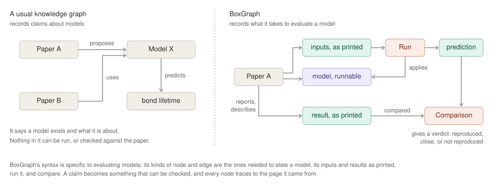

# 1 · The goal

## The problem

Quantitative papers build on each other's numbers and models, but the links
are made in prose. A review can say "Bell's model predicts bond lifetimes
under force" without checking that Bell's printed numbers follow from
Bell's own equations, or that a later paper's "Bell model" is the same
model. Errors travel: a misprinted value or a dropped term in one paper
becomes an input to the next.

Checking this by hand means re-deriving every equation and re-running every
model. Nobody does that for more than a handful of papers.

## What we are building

A literature review that can be executed and audited. It records:

- **what each paper states:** every value with its unit and the page it was
  printed on, every equation as a runnable model, and every input the paper
  leaves unstated, labelled as added;
- **what follows from it:** each paper's models run on the paper's own
  inputs, and compared with what the paper reports;
- **how papers relate:** relations between models, each one tested;
- **what the literature shows as a whole:** what reproduces, where papers
  conflict, and what a problem in one paper puts in doubt in others.

It checks **consistency, not truth**: whether results follow from their own
inputs, and whether papers agree with each other. It doesn't judge whether
a paper is right about the world, and it doesn't summarize papers.

## A syntax for evaluating models

*Figure 1. A usual knowledge graph records claims about models: a paper
proposes a model, the model predicts something, another paper uses it.
Nothing in it can be run or checked. BoxGraph gives the knowledge graph a
structure and a syntax made for evaluating models: the paper's inputs and
results as printed, its model in runnable form, a run, and a comparison
that gives a verdict. Every node traces to the page it came from.*

Three names go with it:

- **BoxGraph** is the syntax: the kinds of node and edge, and the rules
  every one obeys. It is generic. It would be identical for enzyme kinetics,
  pharmacology or epidemiology. A paper fills it; a paper never extends it.
  If a new paper or field needs a new *kind* of thing, BoxGraph is missing
  something general, and the fix goes into it for every field.
- **ModelAtlas** is the part of the graph that joins models across papers:
  every model, as stated, and the relations between them.
- **The Synthesis** is the whole graph read as a review: what each paper
  states, and what checks out within and across papers.

ModelAtlas and the Synthesis are filled from papers. Their rules are the
same in every field. A review may keep a field as a corpus of its own, so
that it reads as one whole; each corpus then has its own ModelAtlas and
Synthesis. Links between fields are worth having (the same rate law appears
in bond rupture, chemical kinetics and fracture), and joining corpora is a
decision left for when two fields need it.

## Principles

1. **Record what was stated, not what was meant.** Every value is entered
   exactly as printed and checked as printed. A reading, a correction or a
   suspected misprint is a separate, labelled thing, never an edit. *Bell
   (1978) prints log t = −14.7 where his own equations give −4.7; correcting
   it would hide the one thing worth knowing.*
2. **Every value has an origin and a citation.** How it came to exist
   (measured, fitted, assumed, predicted, …) and where it comes from: a
   source and a place in it, or an explicit statement that there is none.
3. **Never blur who supplied what.** The paper, a source it cites, and
   anything added by whoever builds the record are different origins. Each
   carries its label wherever it is used.
4. **No hidden choices.** A reading or a setting that changes a result is
   an explicit input to the run, so it appears in the record. An added
   input that matters is run both ways.
5. **Results are produced, never asserted.** A computed value exists only
   because a model ran on recorded inputs. Nothing is deleted or
   overwritten.
6. **Units and meaning are both checked.** Two forces are not the same
   quantity. A value goes into a model or a comparison only if it is the
   quantity expected, under conditions that agree, or the record says why.
7. **Verdicts name their precision.** A value is judged against the
   precision it was printed with.
8. **Reproduced is not the same as verified.** A result that changes as its
   numerical settings are refined belongs to the numerics, not the model.
9. **Disagreement is a result.** The goal is a faithful record, not passing
   checks. "Not reproduced", honestly reached, is a finding.
10. **Doubt is recorded, not settled.** Anything uncertain becomes an open
    question with a kind: a possible error in the paper, an unstated input,
    an unstated model, an unexplained difference, an overstated claim, a
    reading, a choice, a dependence on numerics.
11. **Everything can be rebuilt.** The same papers give the same records
    and the same Synthesis, in any order they were added.
12. **Nothing about any field is built in.** A field's models, quantities
    and sources are content, never part of BoxGraph.
13. **Readings are recorded; records are rebuilt.** Reading a paper into a
    record is a judgement, and two readers can differ. Every record names
    who read it. Two readings of one paper are two records, side by side;
    where they differ is an open question, never an edit. What is rebuilt
    is everything that follows from a record, not the reading itself.

## Where things belong

| Question | If yes, it belongs in |
|---|---|
| Would it be the same in any field? | **BoxGraph** |
| Is it a model, as some paper states it? | **ModelAtlas** |
| Is it a value, source, verdict or finding? | **The Synthesis**, and the paper's record it came from |
| Is it about how one paper was read? | **That paper's record** |
