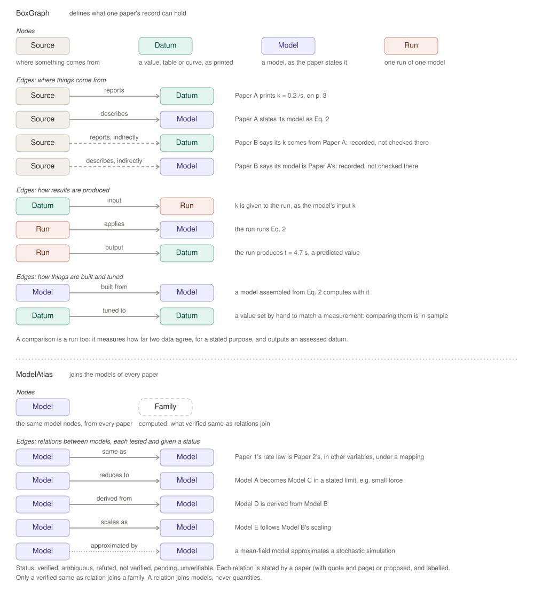
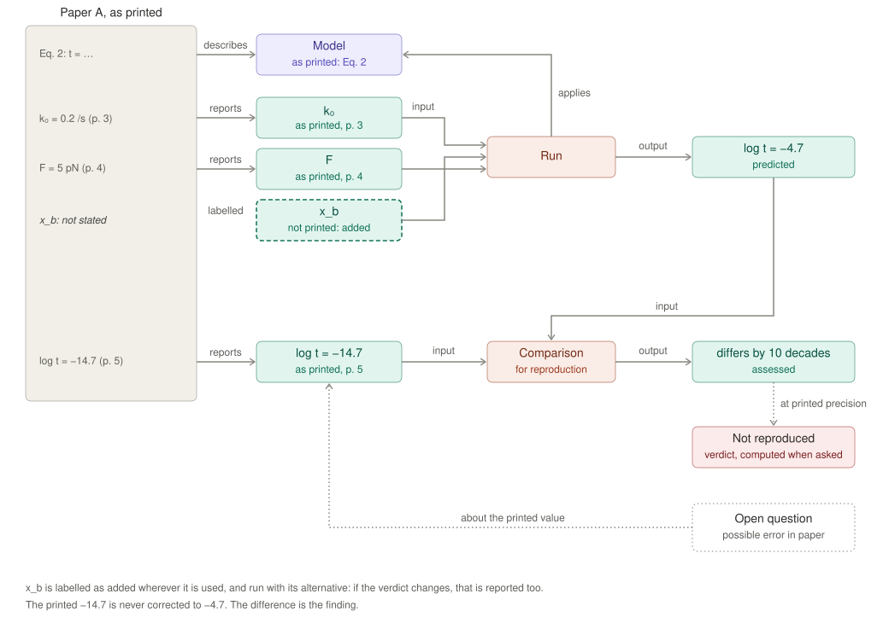
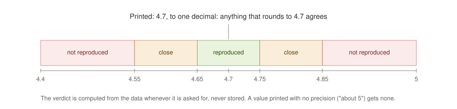
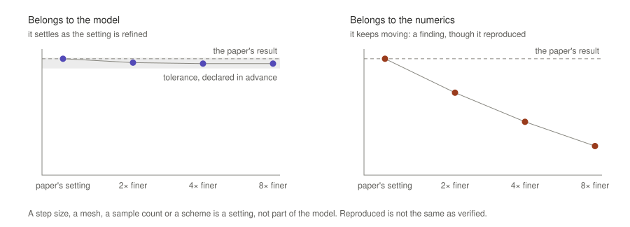

# 2 · BoxGraph

BoxGraph defines what kind of record we are building: what can be written
down about a paper, and the checks that make it trustworthy. It is to
ModelAtlas and the Synthesis what a database's schema and rules are to its
data. Papers supply the content.

## Nodes and edges

*Figure 2. The nodes and edges BoxGraph defines, each edge read as a
sentence with an example; and those ModelAtlas adds: relations between the
models of different papers, and families computed from them (see
[ModelAtlas](03-modelatlas.md)).*

| Node | What it is |
|---|---|
| **Source** | Where something comes from: an article, preprint, thesis, book, dataset, software, a personal communication, or this work. |
| **Datum** | A value with its unit, exactly as printed, with its origin, the quantity it measures, and its citation. A table or a curve is one datum: its values share a unit, a quantity and a citation, and are indexed by a condition such as time or a row label. |
| **Model** | A model as the paper states it, with named inputs and outputs and their units. It computes; it holds no values of its own. |
| **Run** | One model, run once, on recorded inputs and settings. |

**Comparisons are runs too.** A comparison measures how far two data agree,
for a stated purpose: validation against independent data, fit quality,
reproduction of a paper's own result, consistency between two values that
should agree, or how good an approximation is. Its output is a datum like
any other, with the origin *assessed*.

**Origins** say how a datum came to exist: measured, fitted, estimated,
assumed, reported, predicted, derived, run (by a source's own software), or
assessed. A model's role (model, fit, processing, comparison) decides the
origin of what it outputs.

**Code and data are sources too.** A paper's released code and its source
data are read into records of their own, like a paper. A value in them is
cited where it is written: in code by file and lines, with a short quote
that must be on them; in a spreadsheet by sheet and cells, and it must
equal the cells. A printed page does not change, but code and data can, so
the record pins each by a digest of its contents and is unsound when the
files no longer match. The files themselves, like a paper's pages, are
never copied into the record. What a source's own code computes, run as
released, has the origin *run*. A translation of it into another language
is the reader's own model, so what it computes is *predicted*, and the
record says what it was translated from.

Alongside the nodes, the record holds:

- **quantities:** what a datum measures, with its dimension, so units are
  checked against it;
- **conditions:** the circumstances a value was obtained under
  (temperature, cell type, …), checked when two values are compared.
  Two values agree in conditions when every condition both of them name
  has the same value. A condition one of them does not name is noted,
  not a disagreement. A condition they name differently blocks the
  comparison unless a label says why it may go ahead;
- **labels:** anything the paper doesn't state, marked as added, with what
  it rests on and its alternatives;
- **open questions,** each with a kind (see [the goal](01-goal.md),
  principle 10).

## How one paper becomes a graph

*Figure 3. On the left, what Paper A prints. Each printed item becomes a
node through an edge from the paper: the model is described, the inputs and
the result are reported. One input the model needs is not printed: it
becomes a node too, added and labelled, and is run with its alternative. A
run applies the model to the inputs and outputs a prediction. A comparison
takes the prediction and the printed result and outputs their difference,
ten orders of magnitude. The verdict, computed from that difference at the
printed precision whenever it is asked for, is "not reproduced". An open
question about the printed value records a possible error in the paper. The
printed value is never corrected.*

An added input is run with each of its alternatives in turn, one at a
time against the record's own choice, never in every combination: the
runs stay few, and a verdict that changes under any single alternative is
reported.

**A misprinted equation is run both ways.** A model is entered as printed.
When a printed equation is evidently misprinted, because the paper's own
figure, text or released code shows another form, or because a sign or
dimension argument shows the printed form cannot be meant, the record also
holds a variant of the model with the correction. The variant names the
printed model, and for each correction the equation, the change and the
evidence. It is added by the reader, like an added input. Both are run and
compared with the same printed results. The printed model's verdicts stand
as the paper's; the variant's are reported apart, and say whether the
correction accounts for the difference. A printed value is never corrected
this way: only an equation, and only with its evidence.

A record is **sound** when every value traces to the paper or is labelled
as added, every model that can be made to run does run, and units and
quantities agree. A model the paper gives only in words is still entered
as stated, and made runnable if the words allow it. One that cannot be
made runnable stays in the record with an open question that says why,
and whatever depends on it cannot be checked. Soundness is about the
record. Whether the paper reproduces is what the record reports.

## Verdicts

*Figure 4. A value printed as 4.7 allows anything that rounds to 4.7, from
4.65 to 4.75. A result inside that range is reproduced. Outside it by no
more than the range's own width again, it is close, provided it has the
printed value's sign and is within a factor of ten of it. Beyond that, it
is not reproduced.*

Close also means the same sign and the same order of magnitude. When the
printed range does not include zero, a result is close only if it has the
printed value's sign and is within a factor of ten of it. A printed "1"
allows 0.5 to 1.5 and its width again reaches below zero, but a result of
0.000001, or of −0.2, is not reproduced.

A verdict is computed from the data whenever it is asked for, never
stored, so it can't go stale. A value printed without a precision gets no
verdict. A verdict is about the paper as printed, and it says nothing about
whether the paper is right about the world.

The precision is whatever the paper printed:

- a value with decimals or significant figures, including in scientific
  notation, is judged by its last printed digit;
- a value printed with an uncertainty, as 4.7 ± 0.3, is judged by the
  uncertainty, which replaces the printed digits;
- a value printed as a range is judged by the range;
- a value read off a figure is judged by the precision of the reading
  (see below);
- a value with no precision at all, "about 5" or "of order", gets none.

A table or a curve is judged value by value. It reproduces when every
value does, is close when every value is at least close, and otherwise is
not reproduced; the comparison keeps every difference, so the values that
fail are known.

A value computed by a model with randomness has a precision of its own. Such
a model is run several times with different seeds, and its value is the mean
with an interval of two standard errors either side. The verdict then
compares two intervals: reproduced when they overlap, close when the gap
between them is no wider than the printed interval, otherwise not
reproduced. A value from a model without randomness is a single point, and
the rule is the one above. A verdict states both precisions.

**Rounded inputs.** A model is run on its inputs as printed, and printing
rounds them: a paper that computed with 1.26 and printed 1.3 can print a
result that the printed 1.3 does not give. So when a result misses its
printed precision by no more than a tenth of its value, the model is run
again with each printed input at either end of its printed range, one at a
time, and the changes are added up into a range around the computed value.
The verdict then compares that range with the printed one, as for a model
with randomness, and says that the inputs' rounding was used and which
inputs were varied. Only printed inputs are varied, at most eight of them,
the most coarsely printed first; added inputs have no printed rounding. A
result further off is judged as computed, and the comparison says that the
rounding was not tried. A range wider than a tenth of the value either way
always reaches a result that was tried, so for it "reproduced" says that the
paper's printed precision cannot settle the question, not that the value was
pinned down; the range is kept beside the verdict so a reader can tell.

## Values read from figures

Many results are printed only as plotted curves or points. A record must be
able to check them, so reading a figure is part of BoxGraph, not something
left to the eye. A figure reading records:

- the figure and the page it is on;
- its calibration: for each axis, at least two marks whose position on the
  page and whose printed label are both recorded, and whether the axis is
  linear or logarithmic;
- what was read: which curve or which points, and at which positions.

The values are then read from the page by applying the calibration, so a
reading can be rebuilt and checked like any other part of the record, and a
wrong calibration is visible rather than hidden. The precision of each value
comes from the reading itself: how much of the axis one mark on the page
spans, and how thick the line is. That precision is labelled as added,
because the paper did not print it. A figure read only by eye, without a
calibration, gets no verdict.

The papers themselves are not published with a corpus. A build that reads a
figure therefore keeps the numbers it read beside the record, so a copy of the
corpus without the papers still has them; a build that has the paper reads
the figure again and checks them.

Measured data are read from figures like any other values, with their error
bars. A measured value with an error bar is judged by the bar, as a value
printed with ± is, widened by how precisely the bar's ends could be read.
The reading records what the bar is (a standard error, a standard deviation,
a confidence interval, a range) where the paper says so, or that it does not
say. A standard deviation describes the spread of the measurements, not the
uncertainty of their mean, so a verdict against it is a weaker test; the
verdict states which kind of bar it used.

## The model or its numerics

*Figure 5. Two results that both reproduce the paper at the paper's own
numerical setting. As the setting is refined, the first settles within a
tolerance declared in advance: it belongs to the model. The second keeps
moving: it belongs to the numerics, and that is a finding even though it
reproduced.*

A step size, a mesh, a sample count or a numerical scheme is a setting of a
run, not part of the model. Where a result rests on a simulation, the
record shows whether it holds as those settings are refined. A result that
doesn't hold depends on how it was computed, and the record says so.

The paper's own setting is the first of the series. The tolerance is the
paper's where it states one. Where it doesn't, whoever builds the record
declares one, labelled as added, with the reason it was chosen. A result
belongs to the model when, as the setting is refined, the refinements
settle and the value at the paper's own setting is within the tolerance of
where they settle. A result that keeps moving, or settles somewhere else,
belongs to the numerics.

## What BoxGraph guarantees

| Guarantee | Meaning |
|---|---|
| **Checked** | every value traces to its source; units and quantities agree; every added input is labelled; every result is compared with what the paper reports, at its printed precision |
| **Refined** | a result that rests on a simulation is shown to hold, or not, as its numerical settings are refined |
| **Verified** | a relation between two models is tested, not believed (see [ModelAtlas](03-modelatlas.md)) |
| **Rebuilt** | the same papers give the same records and the same Synthesis, in any order |

## What BoxGraph does not contain

- No models of any field.
- No field's quantity lists, sources or conditions: those are content. It
  owns only the rules for them.
- Nothing about any particular paper.
