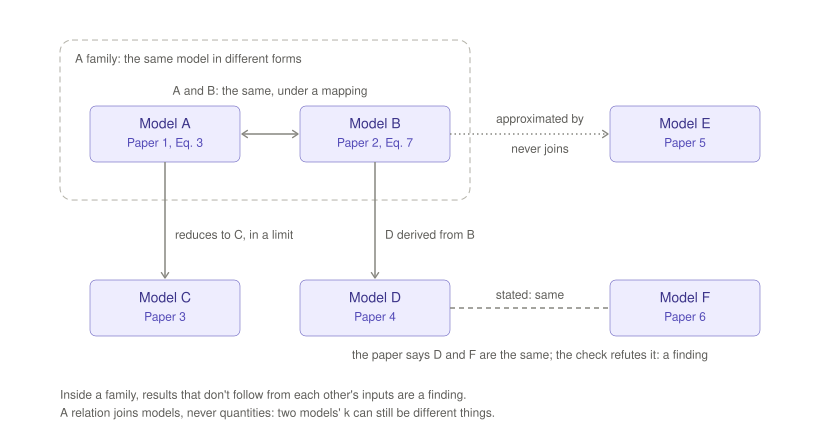

# 3 · ModelAtlas

In mathematics an atlas is a set of charts, each describing the same
territory in its own coordinates, with maps between them. ModelAtlas works
the same way:

- each paper's model is a **chart**, entered as stated, in the paper's own
  symbols and parameters;
- a checked relation, with its mapping, is a **transition map**;
- a **family** of models is a region several charts cover.

*Figure 6. Models A and B are the same model under a mapping: they form a
family. A reduces to C in a limit, and D is derived from B: these are
structure around the family, not part of it. E approximates B; that is
checked, but an approximation never joins a family. Paper 4 says D and F
are the same, and the check refutes it: that is a finding.*

## Every model as stated

A paper's model goes in as the paper prints it, whether or not it
reproduces the paper's own results. A model that doesn't reproduce is
recorded with its verdicts; other papers may still build on it, and that is
worth knowing.

Nothing in ModelAtlas is ever merged or overwritten. Two papers with "the
same model" keep two models, joined by a relation.

## Relations

A relation says how two models connect:

| Kind | Meaning |
|---|---|
| **same as** | the same model in different variables, under a mapping |
| **reduces to** | one becomes the other in a stated limit or regime |
| **derived from** | one is derived from the other |
| **scales as** | one follows the other's scaling |
| **approximated by** | one approximates the other by a closure or truncation that no limit makes exact |

Every relation records its kind, its mapping, any regime or condition, and
where it came from:

- **stated:** a paper says so, with the quote and the page;
- **proposed:** no paper says so, and the record says why it was proposed.

Both are tested the same way, and the test sets a status:

| Status | Meaning |
|---|---|
| **verified** | the relation holds under its mapping, across its stated regime |
| **ambiguous** | it holds in part of the regime, or the test cannot decide |
| **refuted** | shown false, only when shown |
| **not verified** | it does not hold as stated, with what holds instead |
| **pending** | not yet tested |
| **unverifiable** | it cannot be tested: a model does not run, or the steps cannot be applied |

Stated and proposed relations sit side by side, labelled.

What the test is depends on the kind. *Same as* substitutes the mapping
and asks whether the two forms are one. *Reduces to* takes the stated
limit. *Scales as* compares how each form grows. *Approximated by*
measures the error across the regime, and the error is a datum. *Derived
from* is the one that can't always be tested: a derivation has steps, and
a paper often gives the start, the end and some of the steps in words. The
record keeps the steps as the paper gives them, and its assumptions as
labels. Where the steps can be applied, the test applies them and asks
whether they reach the derived model. Where they can't, the relation is
unverifiable, and the paper's words stand as the evidence, labelled as
stated.

## Families

A family is whatever the verified relations connect. It is computed from
the whole atlas every time, so it never depends on which paper came first,
and nobody declares one.

Not every relation joins a family. Approximate relations chain badly: A
close to B and B close to C does not make A close to C.

| Relation | Joins a family? |
|---|---|
| same as, verified | **yes**: the same model in different forms |
| reduces to, derived from | no: structure around a family |
| approximated by, scales as | no: recorded and checked only |
| anything not verified | no |
| a form too plain to mean anything (a ratio, a product) | no, and flagged |

**Conflicts inside a family are findings.** If two papers use what verifies
as the same model, but their results don't follow from each other's
inputs, one of them has a problem. This is the most useful thing the atlas
shows.

## The same form is not the same quantity

A relation joins *models*. It never says that a parameter in one paper is
the same physical quantity as a parameter in another. Two models can be the
same rate law while their "k" are different things. Correspondences between
quantities are listed, with their evidence, and never merged. With one
atlas across fields this matters: a link between fields is normal, and
mostly says nothing about quantities.

When one paper's model is run on another's inputs (see [the
Synthesis](04-synthesis.md)), the mapping says how the symbols translate,
but the inputs are quantities. Every correspondence between quantities the
run relies on, and every input the other paper doesn't state, is an added
label on that run. The result is conditional on them, and says so.
