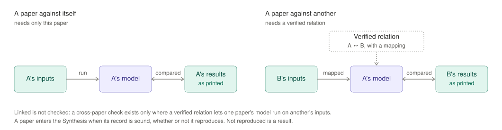

# 4 · The Synthesis

The Synthesis is the new literature review. It holds what every paper
states and measures, what checks out, and what follows across the
literature. A written review is generated from it, and every sentence in
that review traces back to the records.

## What it holds

- **Verdicts:** for each paper, what reproduces, what doesn't, and what
  can't be checked, at the precision the paper printed.
- **Cross-paper checks:** one paper's model run on another paper's inputs,
  wherever a verified relation makes that possible. Each such run lists the
  quantity correspondences and added inputs it rests on.
- **Consistency of cited values:** a value one paper says it takes from
  another is compared with what that paper printed, whenever the cited
  paper is in the record, at the cited paper's precision. This needs no
  relation. A value that travelled wrongly is a finding. The same check
  holds a paper against its own released code and data: a value the paper
  prints is compared with the one written in its code or its source data,
  and a figure the paper plots is compared, value by value at each shared
  condition, with the data it was plotted from. Where two sources print a
  value by different conventions (opposite signs), the link says so and
  the check applies and shows it.
- **Models against other papers' measurements:** a model of one paper,
  run on the conditions of a measurement printed in another, judged at
  that measurement's precision. The record says why the model should
  predict it, and names every quantity of the other paper it takes as the
  same as one of its own. A paper written to explain another's data is
  checked against that data.
- **Findings:** a value that doesn't follow from its own inputs, a stated
  relation that is refuted, a result that belongs to its numerics rather
  than its model, a conflict inside a family. Each traces to the page and
  to the parts of the record behind it.
- **Implications:** what a finding puts in doubt elsewhere: every result
  that runs through it, in the same paper and in others.
- **References:** every work the papers cite, whether it is in the record,
  and which open questions it would settle, so the most useful paper to
  read next is known.

## Kinds of check

*Figure 7. A paper against itself needs only that paper. A paper against
another needs a verified relation that lets one paper's model run on the
other's inputs. A model against another paper's measurement needs the
quantities the two share, named; where the model was fitted to that
measurement, it is reported as a fit.*

| | Needs | Gives |
|---|---|---|
| **A paper against itself** | only that paper | the paper's verdicts |
| **A paper against another** | a verified relation in ModelAtlas | findings across papers |
| **A model against another's measurement** | the shared quantities, named | a test of the model, or the quality of a fit |

**Linked is not checked.** Papers are linked wherever a verified relation
connects their models. A cross-paper check exists only where the link lets
one paper's model run on another's inputs. A cited value is checked
without any relation: it only needs both papers in the record. So is a
model against another paper's measurement: it needs the model, the
measurement, and the stated correspondence of their quantities.

**Entering never requires reproducing.** A paper enters the Synthesis when
its record is sound. Whether its results follow from its inputs is what the
Synthesis reports, not a condition for being in it.
